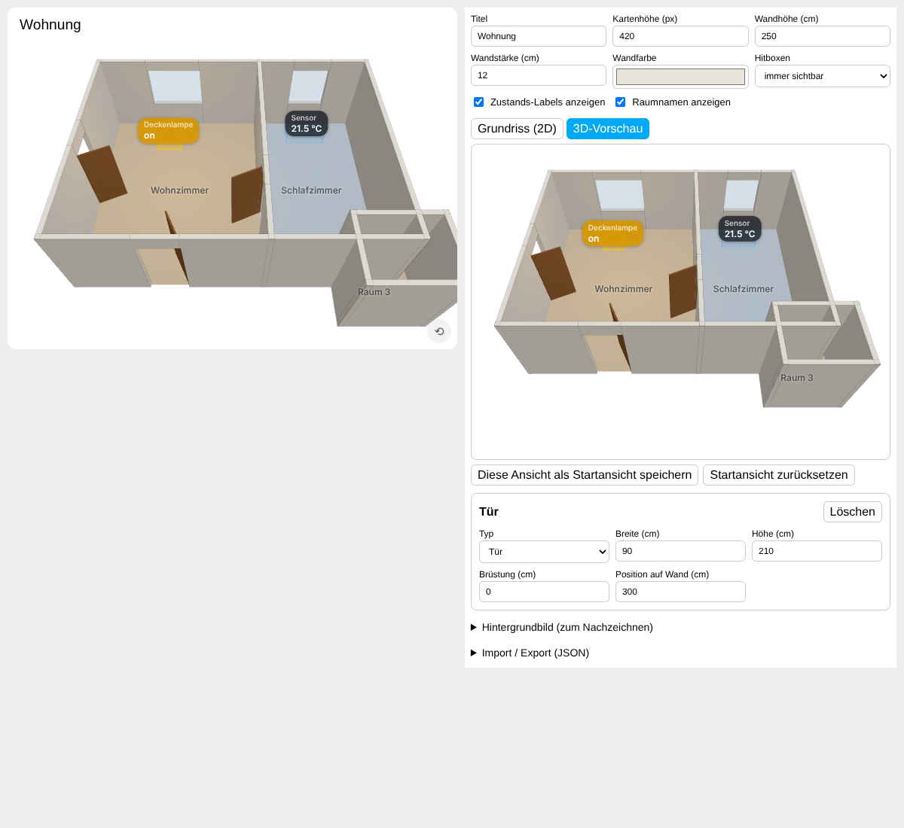

# 3D Floorplan Card für Home Assistant

[](https://my.home-assistant.io/redirect/supervisor_add_addon_repository/?repository_url=https%3A%2F%2Fgithub.com%2FPytronX%2Fha-floorplan-3d)

Eine Home-Assistant-**App** mit einer Dashboard-Karte, mit der du **deine Wohnung als 3D-Grundriss** direkt im Home-Assistant-Dashboard zeichnest – ähnlich wie in SweetHome 3D – und darin **Hitboxen** platzierst, die mit Entitäten verbunden sind: Sensorwerte anzeigen, Lampen schalten, Buttons drücken, Szenen starten …



## Funktionen

- **3D-Ansicht** (Three.js): Wände (auch mit Dachschräge), Türen, Fenster, Räume und Möbel mit Farben oder Texturen; drehen, zoomen, verschieben mit Maus oder Touch.
- **Eingebauter Editor** im normalen Karten-Editor von HA:
  - *Raum + Wände*: Rechteck aufziehen → vier Wände und ein Raum.
  - *Wand*: Wandzüge Punkt für Punkt zeichnen (Raster- und Eckpunkt-Fang, Längenanzeige).
  - *Raum*: Bodenflächen als Rechteck oder Polygon, mit Flächenanzeige in m².
  - *Tür / Fenster*: auf eine Wand klicken, danach entlang der Wand verschieben. 7 Türarten (Drehtür, Doppeltür, Glastür, Balkontür, Schiebetür, Garagentor, Durchgang) und 7 Fensterarten (ein-/zwei-/dreiflügelig, fest, Schiebefenster, bodentief, rund).
  - **Objektbibliothek** wie in SweetHome 3D: Grundformen (Würfel, Kugel, Zylinder, Kegel, Pyramide, Ring …) und Möbel, Leuchten, Küche, Bad, Büro, Treppe usw. mit Vorschaubildern. Anklicken oder in den Grundriss ziehen, dann drehen, skalieren, einfärben oder texturieren.
  - *Hitbox*: Rechteck aufziehen, Entität (mit Suche), Höhe, Icon und Aktionen festlegen.
  - **Etagen**: beliebig viele Stockwerke; die Etage darunter wird beim Zeichnen blass eingeblendet.
  - In jedem Werkzeug: rechte Maustaste gedrückt halten und ziehen = Ansicht verschieben.
  - Verschieben, Eckpunkte ziehen (verbundene Wände ziehen mit), Rückgängig/Wiederholen, Maße direkt eingeben.
  - Wandhöhe am Anfang und Ende getrennt einstellbar (Dachschrägen).
  - Texturen für Wände und Böden: eingebaut (Parkett, Fliesen, Teppich, Backstein, Beton, Rauputz, Tapete) oder eigenes Bild, z. B. `/local/texturen/holz.jpg`.
  - Button „Großansicht“: Editor fast bildschirmfüllend, links die Eingabefelder, rechts Grundriss und/oder 3D-Vorschau (auch beides nebeneinander).
  - Hintergrundbild (z. B. ein eingescannter Grundriss) zum Nachzeichnen.
  - 3D-Vorschau und speicherbare Startansicht der Kamera.
  - Import/Export als JSON.
- **Etagen-Umschalter** oben links auf der Karte, sobald es mehr als eine Etage gibt.
- **Hitboxen**
  - zeigen Name und Zustand als Label (z. B. `21,5 °C`) und leuchten gelb, wenn die Entität „an“ ist;
  - Lampen leuchten in 3D in ihrer echten Farbe mit Leuchtschein, die Helligkeit steht in Prozent im Label;
  - Klick/Tap: *Automatisch* (Licht/Schalter/Ventilator/Cover … umschalten, Button/Szene/Skript auslösen, sonst Info-Dialog), oder fest *Umschalten*, *Auslösen*, *Info-Dialog*, *Nichts*;
  - eigene Aktionen für Halten (Standard: Info-Dialog) und Doppelklick (Standard: nichts);
  - Sichtbarkeit: immer, nur beim Überfahren oder unsichtbar.
- **Eigene Info-Fenster**: Licht mit Helligkeit, Farbe und Weißton; Sensoren mit Verlaufsgrafik; Kamera mit Standbild und Live-Bild; Schalter, Rollladen, Heizung, Medienplayer, Schloss. Wahlweise auch der normale HA-Dialog.

## Installation

1. Auf den Button oben klicken **oder** in Home Assistant *Einstellungen → Apps → App-Store → ⋮ → Repositories* öffnen und `https://github.com/PytronX/ha-floorplan-3d` hinzufügen.
2. Die App **3D Floorplan** installieren und starten.
3. Die App kopiert die Karte nach `/config/www/floorplan-3d/` und trägt sie automatisch als Dashboard-Ressource ein. Wurde der Ordner `www` dabei neu angelegt, Home Assistant einmal neu starten.

Die App braucht Home Assistant OS oder eine Supervised-Installation (dort gibt es den App-Store).

## Benutzung

Dashboard bearbeiten → **Karte hinzufügen** → „3D Floorplan Card“. Die Karte startet mit einer Beispielwohnung, die du anpassen oder unter *Import / Export → Alles löschen* leeren kannst. Alles wird in der Kartenkonfiguration gespeichert – also einfach wie gewohnt auf **Speichern** klicken.

Tipps:
- Leere Fläche ziehen = Ansicht verschieben, Mausrad = Zoom, `Entf` löscht, `Strg+Z` macht rückgängig, `Esc` beendet das Zeichnen.
- Ausgewähltes Objekt: `R` dreht um 90°, `Strg+D` dupliziert; der Punkt vor dem Objekt dreht frei (mit Raster in 15°-Schritten), der Punkt an der Ecke ändert die Größe.
- Eine Deckenlampe ist z. B. eine flache Hitbox mit *Höhe über Boden* 230 cm.

## Karte als ganze Dashboard-Seite

1. Dashboard bearbeiten → neue Ansicht (Tab) hinzufügen → **Ansichtstyp „Panel (einzelne Karte)“** wählen.
2. In dieser Ansicht die 3D Floorplan Card hinzufügen (oder eine vorhandene per Code-Editor hineinkopieren).
3. Im Karten-Editor **„Ganze Dashboard-Seite ausfüllen“** anhaken. Die Karte füllt dann Breite und Höhe der Seite aus und passt sich der Fenstergröße an.

Zusätzlich hat jede Karte unten rechts einen **Vollbild-Button**.

## Konfiguration (YAML)

Alle Maße in **Zentimetern**. Normalerweise musst du das nicht von Hand schreiben.

```yaml
type: custom:floorplan-3d-card
title: Wohnung
height: 420              # Kartenhöhe in px
full_page: false         # true = ganze Seite ausfüllen (Panel-Ansicht)
wall_height: 250
wall_thickness: 12
wall_color: "#e8e4dc"
wall_texture: builtin:plaster   # optional, Standard für alle Wände
floor_texture: builtin:wood     # optional, Standard für alle Böden
hitbox_mode: visible     # visible | hover | hidden
show_labels: true
show_room_names: true
show_area: true          # Raumfläche in m² anzeigen
info_dialog: card        # card = eigenes Info-Fenster, ha = Standard-Dialog von HA
camera:                  # optional, wird über den Editor gesetzt
  position: [4, 8, 9]
  target: [4, 0, 3]
background:              # optional, nur im Editor sichtbar
  image: /local/grundriss.png
  width: 1000
  opacity: 0.5
floorplan:
  walls:
    - { id: w1, x1: 0, y1: 0, x2: 800, y2: 0 }
    - { id: w2, x1: 800, y1: 0, x2: 800, y2: 600, height: 320, height_end: 180, texture: "builtin:brick" }
  openings:
    - { id: o1, wall: w1, type: window, style: double, offset: 200, width: 120, height: 130, sill: 90 }
    - { id: o2, wall: w2, type: door, style: single, flip: true, mirror: false, color: "#ffffff", offset: 300, width: 90, height: 210 }
    # Türen: single | double | glass | french | sliding | garage | opening
    # Fenster: single | double | triple | fixed | sliding | round
  rooms:
    - { id: r1, name: Wohnzimmer, texture: "builtin:wood", texture_scale: 120, points: [[0, 0], [800, 0], [800, 600], [0, 600]] }
  hotspots:
    - id: h1
      entity: light.wohnzimmer
      x: 240        # Mittelpunkt
      y: 300
      z: 230        # Unterkante über dem Boden
      w: 60
      d: 60
      h: 15
      label: Deckenlampe
      icon: mdi:ceiling-light
      action: auto  # auto | toggle | press | more-info | none
      hold_action: more-info      # Standard
      double_tap_action: toggle   # Standard: none
  objects:
    - { id: b1, type: sofa, x: 390, y: 330, w: 220, d: 95, h: 85, rotation: 90, color: "#6f7f8f" }
    - { id: b2, type: sphere, x: 100, y: 100, z: 0, w: 50, d: 50, h: 50, texture: "builtin:concrete" }
```

`type` ist der Name aus der Objektbibliothek, z. B. `box`, `sphere`, `cylinder`, `cone`, `pyramid`, `torus`, `hemisphere`, `wedge`, `sofa`, `armchair`, `bed_double`, `wardrobe`, `dining_table`, `chair`, `kitchen_base`, `fridge`, `bathtub`, `toilet`, `desk`, `floor_lamp`, `ceiling_lamp`, `stairs`, `car` … (`rotation` in Grad im Uhrzeigersinn).

Mehrere Etagen stehen statt unter `floorplan` unter `floors`:

```yaml
floors:
  - id: eg
    name: Erdgeschoss
    floorplan: { walls: [...], openings: [...], rooms: [...], hotspots: [...] }
  - id: og
    name: Obergeschoss
    floorplan: { ... }
```

## Entwicklung

```bash
npm install
npm run watch      # baut floorplan_3d/www/floorplan-3d-card.js bei jeder Änderung
npm run typecheck
npm run build
```

Das gebaute `floorplan_3d/www/floorplan-3d-card.js` wird mit eingecheckt, weil es in das App-Image kopiert wird. Der App-Teil (Dockerfile, `config.yaml`, Python-Dienst für Installation und Seitenleisten-Panel) liegt in `floorplan_3d/`.

## Ideen für später

- Eigene 3D-Modelle (glTF) einfügen
- „Puppenhaus“-Modus, der Wände zur Kamera hin ausblendet
- Räume einfärben nach Sensorwerten (z. B. Temperatur)

Beiträge und Issues sind willkommen!

## Lizenz

MIT
